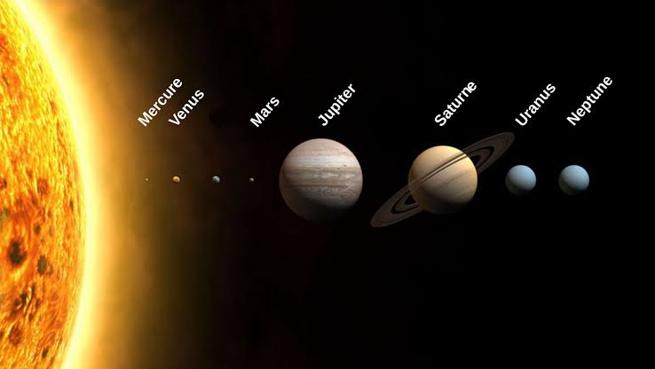

# Les planètes du système solaire

Me Voilà Tardivement Mesurée, je suis une naine.
Mercure
Vénus
Terre
Mars
Jupiter
Saturne
Uranus
Neptune

	
[Lien de l'image](https://www.mnhn.fr/fr/combien-y-a-t-il-de-planetes-dans-le-systeme-solaire)	

