# BitChat : discuter sans Internet grâce au Bluetooth

*Test réalisé le 7 novembre 2026 avec deux iPhones.*

> **En bref**
>
> BitChat est une messagerie qui fonctionne sans compte, sans numéro de téléphone et sans serveur : les téléphones proches s'écrivent directement par Bluetooth.
>
> Je l'ai testée avec un iPhone 16 et un iPhone XR, en mode avion et avec seulement le Bluetooth activé. Ça marche : détection en environ une minute, message public, puis message privé chiffré.

## C'est quoi BitChat ?

BitChat est une application de messagerie décentralisée. Contrairement à WhatsApp ou Messenger, elle ne demande ni compte, ni numéro de téléphone, ni adresse e-mail, et elle ne passe par aucun serveur central. Deux téléphones qui ont l'application et qui sont à portée l'un de l'autre se parlent directement en Bluetooth, même sans réseau mobile ni Wi-Fi.

Chaque téléphone peut aussi servir de relais : un message peut sauter d'un appareil à l'autre pour aller plus loin que la portée d'un seul Bluetooth. On appelle ça un réseau maillé (« mesh »). Selon le dépôt du projet, un message peut traverser jusqu'à 7 relais.

C'est utile quand le réseau est coupé ou saturé (panne, festival, zone sans couverture) ou quand on veut communiquer sans laisser de trace sur un service centralisé.

## Comment ça marche ?

| Mode | Ce qu'il utilise | Internet nécessaire ? |
|---|---|---|
| Canal #mesh | Bluetooth basse consommation, uniquement les personnes à portée | Non |
| Canaux par lieu | Le réseau Nostr, avec un canal par zone géographique | Oui |
| Messages privés | Chiffrement de bout en bout (protocole Noise) | Selon le mode utilisé |

L'application se pilote avec quelques commandes tapées dans la zone de message. Quand on tape « / », une petite barre affiche l'aide de la commande :

- `/who` : voir qui est en ligne
- `/msg <pseudo>` : envoyer un message privé
- `/slap` : une commande « humoristique » héritée des anciens chats IRC

Chaque utilisateur reçoit automatiquement un pseudo du type « anon1234 », sans rien avoir à créer.

## Mon test

**Matériel :** un iPhone 16 (pseudo anon6051) et un iPhone XR (pseudo anon6525), posés l'un à côté de l'autre.

**Conditions :** mode avion activé, Wi-Fi et données mobiles coupés, seul le Bluetooth est allumé. Comme ça, si les messages passent, c'est forcément par le Bluetooth.

**Objectif :** vérifier que deux téléphones proches peuvent s'écrire sans aucun réseau, et voir comment l'application se comporte.

## Déroulement

### Étape 1 : le Bluetooth est coupé (12:46)

Au départ, le Bluetooth est désactivé. BitChat le signale tout de suite : une fenêtre « bluetooth requis » apparaît et un bandeau rouge explique que personne à proximité ne peut nous joindre. Le compteur de personnes en haut à droite affiche 0.

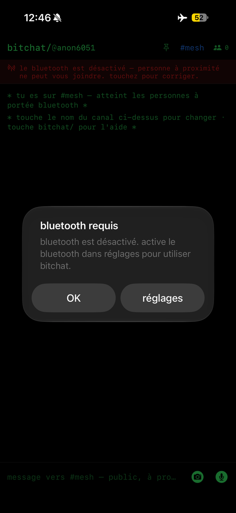
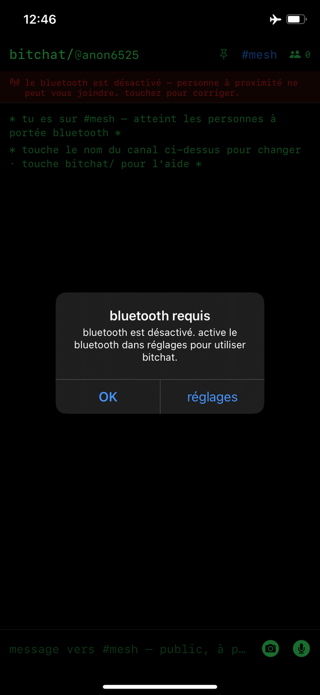

*Figure 1 : sans Bluetooth, BitChat ne peut joindre personne (à gauche l'iPhone 16, à droite l'iPhone XR, 12:46).*

### Étape 2 : les deux téléphones se détectent (12:47)

Environ une minute après avoir activé le Bluetooth, les deux iPhones affichent la notification « des bitchatteurs dans le coin ! 1 personne dans les parages ». Ils se sont trouvés tout seuls, sans réseau.

Autre point utile : le message d'accueil précise « tu es sur #mesh : atteint les personnes à portée bluetooth ». Autrement dit, #mesh est le canal Bluetooth. Il n'existe pas de canal « #bluetooth » à rejoindre : on est déjà dedans.

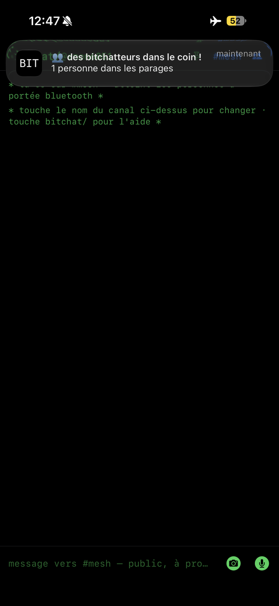
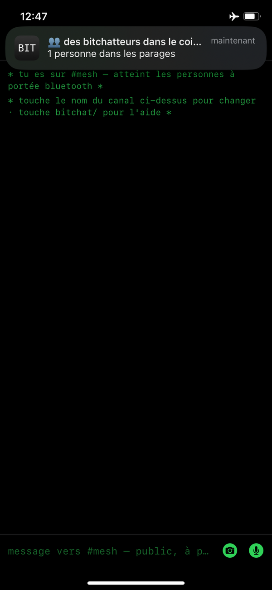

*Figure 2 : la notification de proximité apparaît sur les deux téléphones (à gauche l'iPhone 16, à droite l'iPhone XR, 12:47).*

### Étape 3 : un message public sur #mesh (12:50)

J'envoie « Salut » depuis l'iPhone 16 à 12:50:03. Il arrive sur l'iPhone XR avec la même heure. L'XR répond à 12:51:24 ; ce délai vient surtout de ma saisie à la main, il ne mesure pas la vitesse de l'application. Ensuite, la commande `/who` confirme la présence de l'autre téléphone : « en ligne : anon6525 ».

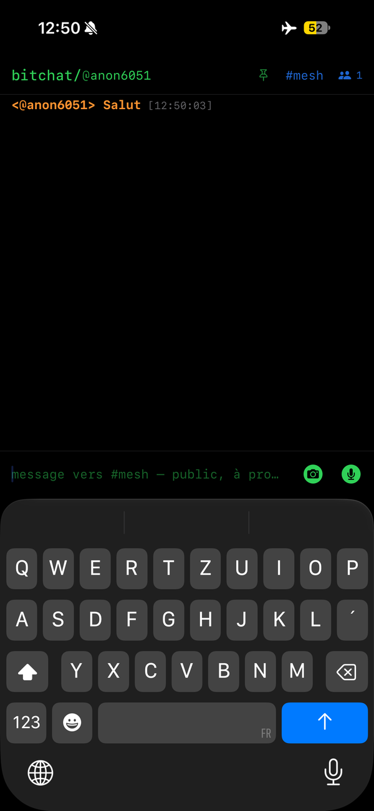
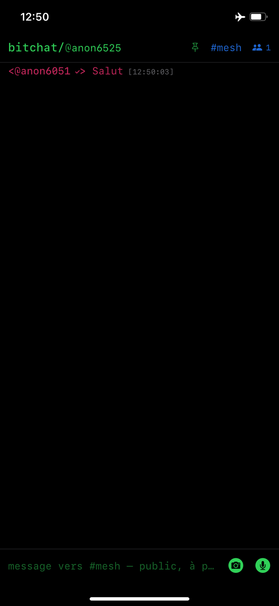
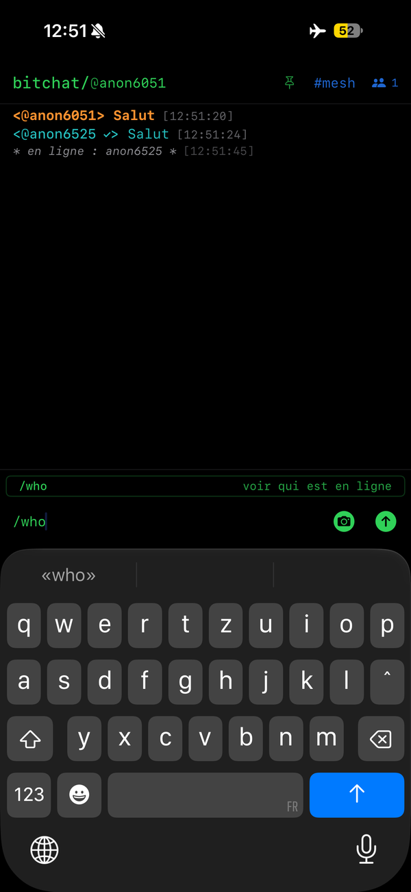

*Figure 3 : message public envoyé (iPhone 16, 12:50), reçu (iPhone XR, 12:50), puis commande /who (iPhone 16, 12:51).*

### Étape 4 : un message privé chiffré (12:58)

Avec `/msg anon6525`, l'iPhone 16 ouvre une conversation privée. L'écran change de couleur (orange au lieu de vert) et la mention « privé · chiffré de bout en bout » s'affiche au-dessus de la zone de saisie. Un badge vert à côté du pseudo apparaît aussi.

Côté iPhone XR, la notification dit seulement « nouveau mp : ouvre bitchat pour lire ». Le contenu du message n'est pas montré sur l'écran de verrouillage, ce qui est une bonne chose pour la confidentialité.

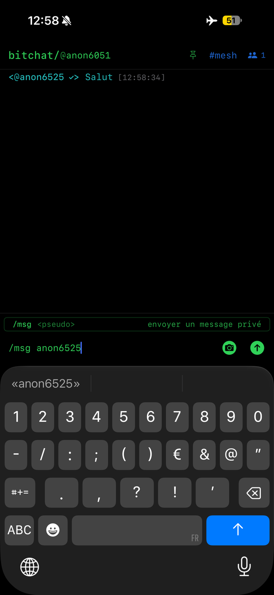
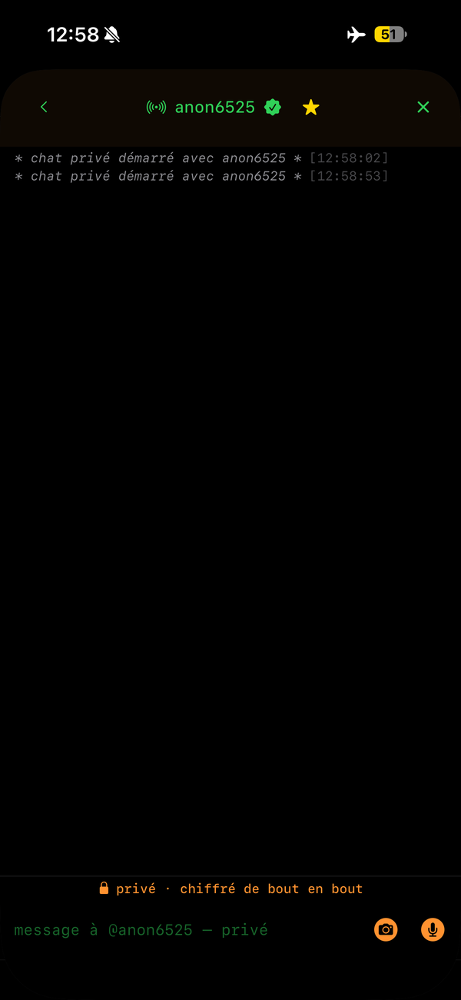
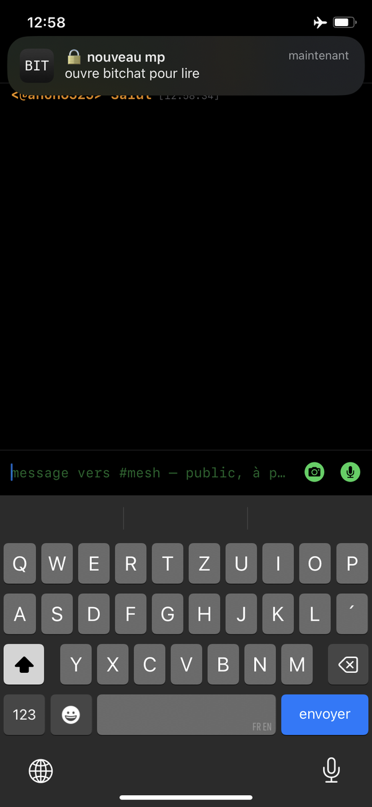

*Figure 4 : ouverture d'un chat privé (iPhone 16) et notification côté destinataire (iPhone XR).*

### Étape 5 : effacer une discussion (12:59)

L'application permet d'effacer une discussion après confirmation (« effacer cette discussion ? »). Pratique pour ne rien laisser sur le téléphone après un test.

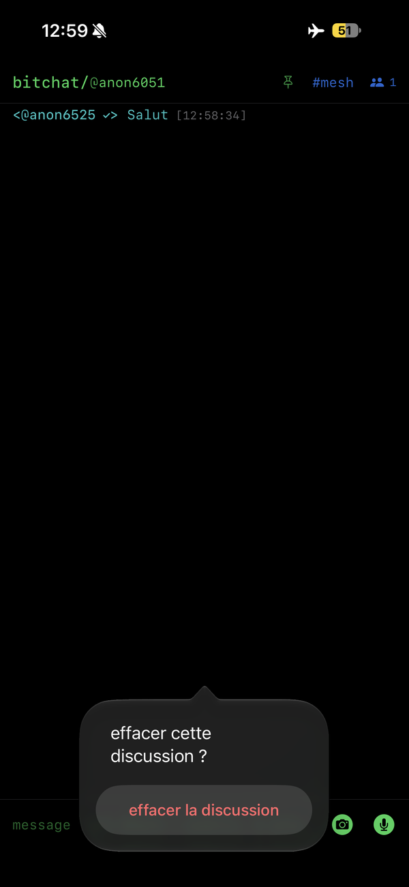
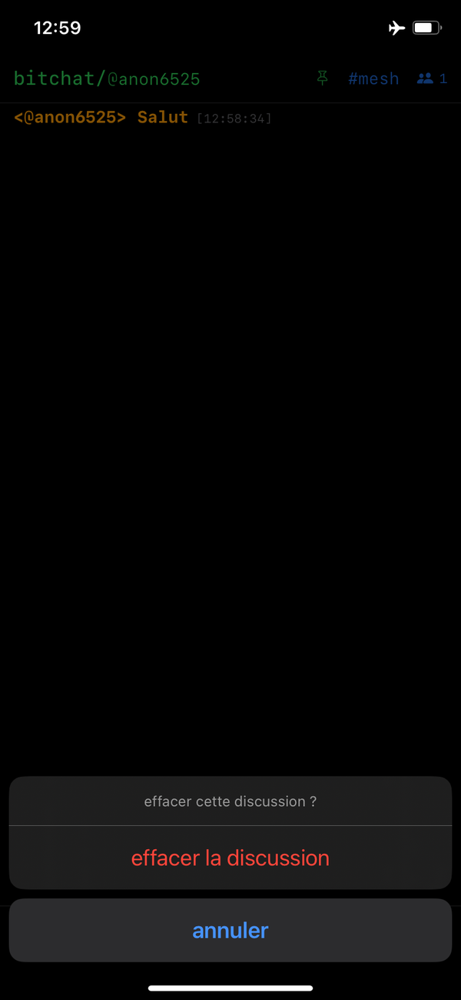

*Figure 5 : confirmation avant d'effacer la conversation (à gauche l'iPhone 16, à droite l'iPhone XR, 12:59).*

## Ce que je retiens

- Ça marche vraiment sans réseau : mode avion, Wi-Fi coupé, seul le Bluetooth suffit.
- Les deux téléphones se trouvent en environ une minute, sans rien configurer.
- Pas de compte ni de numéro : l'appli donne un pseudo automatique du type « anon1234 ».
- Les messages privés sont chiffrés de bout en bout, et les notifications ne révèlent pas leur contenu.
- L'interface ressemble à un terminal : sobre, mais il faut connaître les commandes `/who` et `/msg`.

Une réserve : le dépôt du projet indique que l'identifiant utilisé par le Bluetooth est propre à l'appareil et persistant. Sans compte, on n'est donc pas pour autant invisible pour les téléphones qui passent à proximité.

## Ce que je n'ai pas encore testé

- La portée : à quelle distance et à travers quels obstacles le message passe encore (avec une mesure de la force du signal, le RSSI).
- Le relais sur plusieurs sauts, qui demande au moins trois téléphones.
- Les canaux par lieu, qui passent par Internet.
- Le délai exact d'envoi, mesuré à la milliseconde plutôt qu'à la seconde.

## Sources

- Dépôt officiel de BitChat : [github.com/permissionlesstech/bitchat](https://github.com/permissionlesstech/bitchat)
- Captures d'écran réalisées lors de mon test, le 7 novembre 2026.
