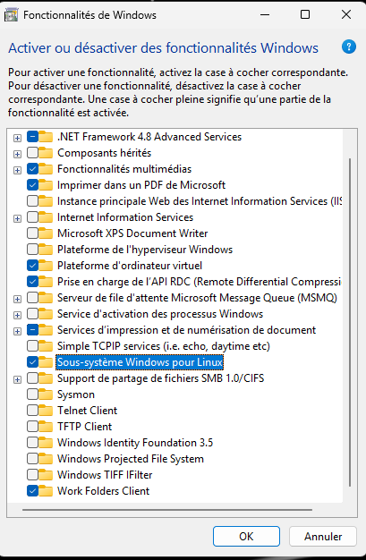
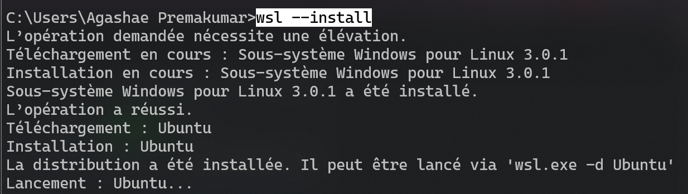
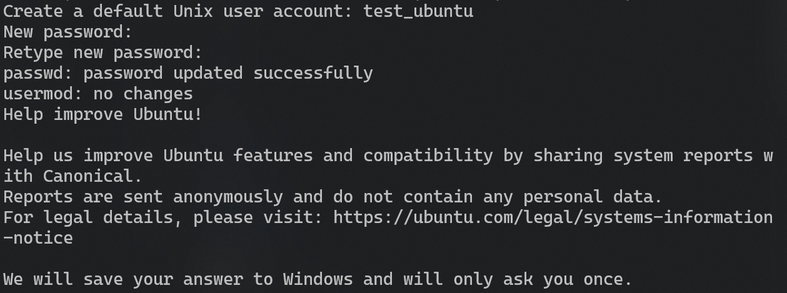
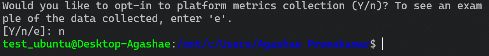
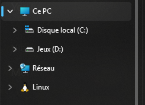

# WSL : Windows Subsystem for Linux

## Pourquoi WSL ?

Windows Subsystem for Linux fait tourner un vrai système Linux à l'intérieur de Windows, sans machine virtuelle à configurer à la main ni double démarrage.

## Prérequis

Dans *Activer ou désactiver des fonctionnalités Windows*, cocher **Sous-système Windows pour Linux** et **Plateforme d'ordinateur virtuel**, puis redémarrer.



## Installation

Sur une machine Windows 10 (version 2004 ou plus récente) ou Windows 11, ouvrir PowerShell en tant qu'administrateur et lancer :

```powershell
wsl --install
```

Un redémarrage est demandé. 
<br>
Au premier lancement, il faut choisir un nom d'utilisateur et un mot de passe Linux (ils sont indépendants de ceux de Windows).





La question de télémétrie qui suit est facultative : répondre `n` n'a aucun impact sur le fonctionnement.



Une fois dans le terminal, mettre le système à jour :

```bash
sudo apt update && sudo apt upgrade -y
```


Pour voir les autres distributions disponibles :

```powershell
wsl --list --online
```

Pour en installer une autre, par exemple Debian :

```powershell
wsl --install -d Debian
```

## Vérifier et gérer les versions

WSL existe en deux versions. La version 2 utilise un vrai noyau Linux et offre de meilleures performances, c'est celle à privilégier.

```powershell
wsl --list --verbose      # liste les distributions et leur version (colonne VERSION)
wsl --set-default-version 2
wsl --update              # met à jour le composant WSL
wsl --status              # affiche les informations générales
```


## Accéder aux fichiers dans les deux sens

Depuis Windows, les fichiers Linux sont visibles dans l'Explorateur, dans l'entrée *Linux*, ou en tapant `\\wsl$` dans la barre d'adresse.



Depuis Linux, les disques Windows sont montés dans `/mnt` :

```bash
ls /mnt/c/Users/
```

**Conseil :** pour les projets où les performances comptent (dépôts Git, dépendances Node.js ou Python), garder les fichiers dans le système Linux, par exemple dans `~/projets`, plutôt que dans `/mnt/c`. Les accès entre les deux systèmes sont nettement plus lents.

## Configurer WSL avec `.wslconfig`

Les ressources allouées à WSL 2 se règlent dans un fichier `.wslconfig` placé dans le dossier utilisateur Windows (`C:\Users\<nom>\.wslconfig`). Exemple :

```ini
[wsl2]
memory=4GB
processors=4
swap=2GB
networkingMode=mirrored
```

Quelques remarques :

- `memory` et `processors` limitent ce que la machine virtuelle peut consommer. Sans cette limite, WSL peut occuper une grande partie de la RAM.
- Après une modification, il faut relancer WSL avec `wsl --shutdown`.
- Le mode réseau `mirrored` est disponible sur Windows 11 récent. Il simplifie l'accès réseau entre Windows et Linux, en partageant les adresses IP de la machine hôte.